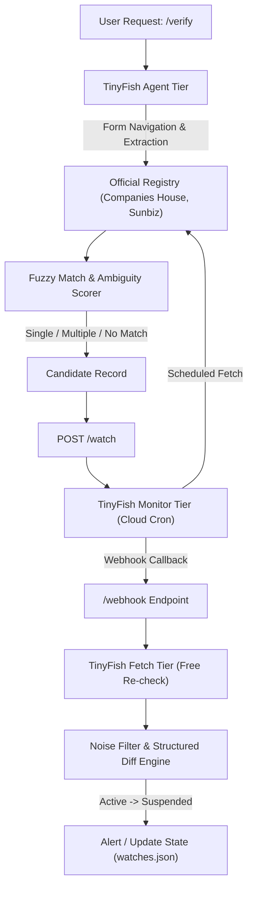

# TinyVerify 🔍
> **Autonomous Entity & License Verification Pipeline powered by TinyFish**

TinyVerify is a reliable, automated compliance and background verification system built on **TinyFish AI**. It automatically searches public registries, handles name variants and ambiguity, monitors official record pages for changes, and delivers real-time structured diffs via webhooks.

---

## 💡 5-Line Core Mechanism
1. **Agent Search**: Dynamically interacts with official search forms across jurisdictions without requiring static APIs.
2. **Ambiguity Resolution**: Categorizes matches into `single_match`, `multiple_matches`, or `no_match` based on token sort ratios.
3. **Zero-Cost Fetch**: Uses TinyFish's free Fetch API with regex parsing to re-verify status in milliseconds without burning credits.
4. **Scheduled Monitor**: TinyFish Cloud Monitors watch live record URLs on a schedule (`*/15 * * * *`) and trigger webhooks.
5. **Noise Filter & Diff**: Compares only compliance-critical fields (`status`, `status_date`, `expiry_date`, `disciplinary_actions`), ignoring page layout churn.

---

## 🏗️ 3-Tier Architecture



---

## 🌐 Tested & Supported Registries (Verified: 2026-11-07)

| Registry Key | Registry Name | Jurisdiction | Record Type | Verified Status | Extraction Method |
|---|---|---|---|---|---|
| `uk_companies_house` | UK Companies House | `UK` | `company_registration` | ✅ **Live Verified** | Agent Search + Fetch Regex |
| `fl_sunbiz` | Florida Division of Corporations | `US-FL` | `company_registration` | ✅ **Live Verified** | Agent Search + Fetch Regex |
| `ca_dca` | California Dept. of Consumer Affairs | `US-CA` | `professional_license` | ⚠️ **Experimental** (Complex accordion forms) | Agent Search + Fallback |

---

## 🚀 Quickstart

### 1. Environment Setup
```powershell
# Open terminal inside tinyverify:
venv\Scripts\activate
pip install tinyfish fastapi uvicorn rapidfuzz python-dotenv
```

Ensure `.env` contains your key and optional public URL:
```env
TINYFISH_API_KEY=your_key_here
PUBLIC_URL=https://your-tunnel.ngrok-free.app  # Optional for live webhooks
```

### 2. Start the API Server
```powershell
uvicorn app:app --reload
```
Interactive Swagger UI available at: `http://127.0.0.1:8000/docs`

### 3. Setting Up Webhook Tunnel (ngrok)
`ngrok.exe` is bundled right inside the project folder:
```powershell
.\ngrok.exe config add-authtoken <your-token>
.\ngrok.exe http 8000
```
Copy the assigned `https://...ngrok-free.app` URL into `.env` as `PUBLIC_URL` and restart uvicorn.

---

## 📡 API Endpoints

### 1. `POST /verify`
Verifies an entity across official registries.

**Request:**
```json
{
  "name": "Publix",
  "record_type": "company_registration",
  "jurisdiction": "US-FL"
}
```

**Response (Multiple Matches / Ambiguity):**
```json
{
  "query": { "name": "Publix", "record_type": "company_registration", "jurisdiction": "US-FL" },
  "results": [
    {
      "registry": "Florida Division of Corporations (Sunbiz)",
      "result": "multiple_matches",
      "needs_confirmation": true,
      "records": [
        {
          "name": "PUBLIX",
          "status": "Inactive",
          "raw_status": "INACT",
          "license_number": "910940",
          "match_type": "exact",
          "match_score": 100,
          "source_url": "https://search.sunbiz.org/Inquiry/CorporationSearch/SearchResultDetail?..."
        }
      ]
    }
  ]
}
```

### 2. `POST /watch`
Registers a record for continuous cloud monitoring.
```json
{
  "registry_key": "uk_companies_house",
  "record": {
    "name": "TESCO PLC",
    "license_number": "00445790",
    "status": "Active",
    "source_url": "https://find-and-update.company-information.service.gov.uk/company/00445790"
  }
}
```

### 3. `POST /recheck/{watch_id}`
Triggers an immediate, zero-cost Fetch status check. Returns `changed: false` when status remains unchanged.

### 4. `POST /test/simulate-change/{watch_id}`
> **Note:** This is a *simulated demo endpoint* created specifically to prove that the structured diff and alert pipeline triggers cleanly on status divergence (`Active` vs. `Suspended (simulated)`).

```json
{
  "watch_id": "uk_companies_house:00445790",
  "changed": true,
  "diff": {
    "status": {
      "old": "Suspended (simulated)",
      "new": "Active"
    }
  },
  "method": "fetch"
}
```

---

## 🛡️ Known Limitations & Future Roadmap
- **Company Registries**: Fully verified for UK Companies House and Florida Sunbiz.
- **Dynamic Multi-Tab License Boards**: California DCA uses nested JavaScript tab panels where automated navigation can require 25+ browser steps; future versions will target simpler single-form state medical licensing boards (e.g., Texas or New York).
